# psycBridge - Complete Detailed Design + ER (DesignER)
**Phase:** SDLC - 2. Design (Detailed)
**Version:** 2.0 Full | **Date:** 2026-10-10
**Inputs:** `requirements.md` v1.0 + `design.md` v1.0
**Audience:** Implementation session (fresh agent) - must be able to scaffold DB + API + App with ZERO re-asking
**Pilot:** 5-6 volunteers, 50 users, Talk Hours 19:00-23:00 IST

> This file is COMPLETE. If anything conflicts, this file wins over `design.md` v1.0 for implementation.

---

## TABLE OF CONTENTS
1. [Architecture - What + How](#1-architecture---what--how)
2. [Complete ER Diagram (Mermaid)](#2-complete-er-diagram-mermaid)
3. [Table-by-Table Data Dictionary](#3-table-by-table-data-dictionary)
4. [Full PostgreSQL DDL (copy-paste runnable)](#4-full-postgresql-ddl-copy-paste-runnable)
5. [State Machines](#5-state-machines)
6. [Sequence Diagrams (all core flows)](#6-sequence-diagrams-all-core-flows)
7. [API Field-Level Spec](#7-api-field-level-spec)
8. [Redis / Realtime Design](#8-redis--realtime-design)
9. [Privacy Masking Matrix + Data Flows](#9-privacy-masking-matrix--data-flows)
10. [UI Screen Map + Navigation](#10-ui-screen-map--navigation)
11. [Build Checklist for Implementation Session](#11-build-checklist-for-implementation-session)

---

## 1. Architecture - What + How

### 1.1 WHAT: System Context (C4 L1)

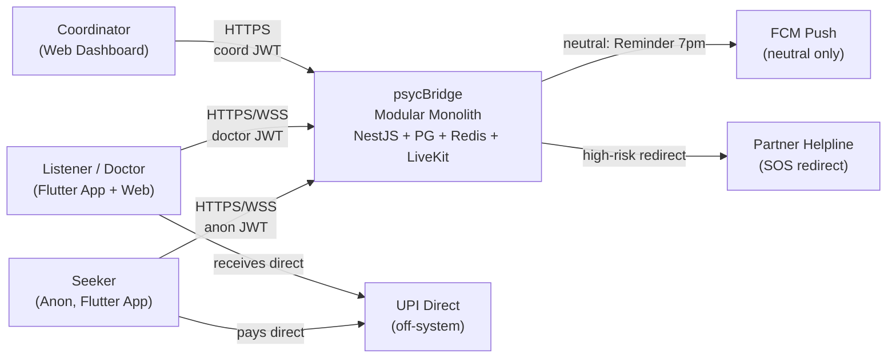

**HOW to read:** Seeker never touches DB directly. All writes go via NestJS modules. Payments NEVER touch backend V1 (only `fee_snapshot` stored for display).

### 1.2 HOW: Container / Module View (C4 L2)

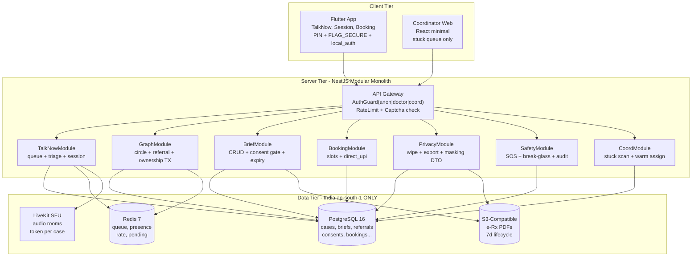

**Module -> Folder mapping (implementation MUST follow):**
```
/server/src/modules/talk-now/      -> M1
/server/src/modules/graph/         -> M2 (circle + referral + transfer_ownership)
/server/src/modules/brief/         -> M3
/server/src/modules/booking/       -> M4
/server/src/modules/privacy/       -> M5
/server/src/modules/safety/        -> M6
/server/src/modules/coordinator/   -> M7
/server/src/common/guards|dto|prisma
/app/lib/features/{talk_now,session,referral,booking,privacy}
```

### 1.3 Deployment (V1 Pilot - Cheap)

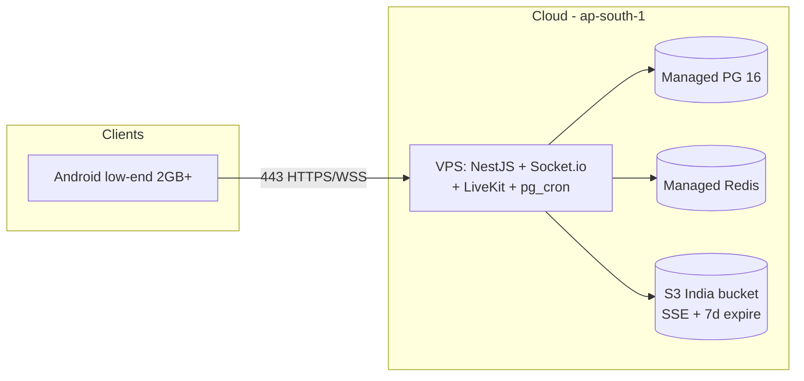

---

## 2. Complete ER Diagram (Mermaid)

> Copy this block into https://mermaid.live to visualize. This is the SOURCE OF TRUTH for tables.

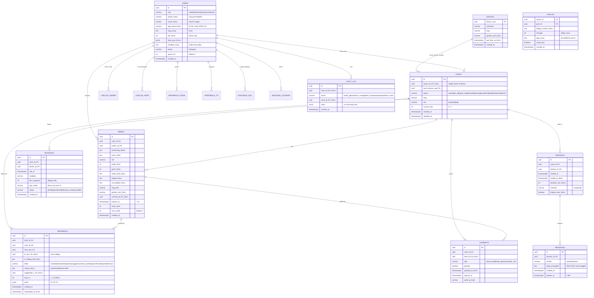

### Relationship Rules (read with diagram)
- `DEVICES 1:N CASES` - one device can have many TalkNows over days, but 1 free/24h.
- `USERS 1:N CIRCLES (as owner)` + `USERS 1:N CIRCLES (as peer)` - self-join, max 10 per owner enforced in service (not DB).
- `CASES 1:N REFERRALS` - chain history preserved, never deleted, only expired.
- `BRIEFS 1:1 CONSENT (per share)` - each slide needs fresh patient consent row.
- `MESSAGES N:1 SESSIONS` - auto-burn, never FK to users (alias only).

---

## 3. Table-by-Table Data Dictionary

### 3.1 devices (anon seeker identity V1)
| Column | Type | Null | Default | What + How + Example |
|--------|------|------|---------|----------------------|
| device_uuid | UUID PK | NO | gen_random_uuid() | Client-generated `uuidv4` + stored in secure storage. Signed into anon JWT. Ex: `dev_9f3...` |
| nickname | VARCHAR(24) | NO | auto | `QuietFox12` - adjective+animal+2digits. Regeneratable. Never real name. |
| lang | VARCHAR(8) | NO | 'hi' | `hi`/`en` V1. Drives queue match. |
| gender_pref | VARCHAR(16) | YES | NULL | `no_pref`/`female`/`male`. Soft match only, never blocks queue. |
| last_free_at | TIMESTAMPTZ | YES | NULL | Set on `/talk-now/join` success. Guard `now() - last_free_at < 24h => 429`. Also Redis mirror. |
| created_at | TIMESTAMPTZ | NO | now() | - |

### 3.2 users (doctors/listeners + later seekers with account)
| Column | Type | Null | Default | What/How |
|--------|------|------|---------|----------|
| id | UUID PK | NO | gen_random_uuid() | - |
| role | VARCHAR(16) | NO | - | CHECK in (`seeker`,`listener`,`doctor`,`coordinator`). Listener=peer/junior for TalkNow. Doctor=can own+refer. |
| phone | VARCHAR(16) | YES | NULL | NULL till post-help reminder OR Rx stage. E.164. Never shown to other party. |
| name | VARCHAR(80) | YES | NULL | NULL till Rx stage (FR-45 stepped ID). Never in masked preview. |
| age_band | VARCHAR(16) | YES | NULL | `18-24`,`25-34` etc. B sees band, never DOB. |
| lang | TEXT[] | NO | `{en,hi}` | GIN index. Matching: overlap count ranking. |
| fee | INT | YES | NULL | INR, doctor sets. `fee_snapshot` copied to booking (no commission calc V1). Ex: 800. |
| slots_json | JSONB | YES | NULL | `[{day:"tue", from:"19:00", to:"23:00", modality:["audio"]}]`. Booking checks overlap. |
| modality | TEXT[] | NO | `{audio,chat}` | Doctor allowed channels. |
| status | VARCHAR(16) | NO | 'space' | `full` = reject auto-suggest, `space` = accept. Toggle in D0. |
| space_for | INT | NO | 3 | Remaining capacity hint. Decremented on pending++. |
| created_at | TIMESTAMPTZ | NO | now() | - |

### 3.3 circles (My Circle 5-10)
| Column | Type | Null | Default | What/How |
|--------|------|------|---------|----------|
| owner_id | UUID FK->users | NO | - | PK(owner_id,peer_id). Owner must be doctor/listener. |
| peer_id | UUID FK->users | YES | NULL | NULL if off-app (only `offapp_contact` set). |
| offapp_contact | TEXT | YES | NULL | Hashed phone/link for off-app B. Expiring link stores `to_offapp_link` in referrals, not here. |
| strength | INT | NO | 1 | `+1` on every successful Yes-transfer. Used for ranking suggest. |
| tags | TEXT[] | NO | `{}` | `["de-addiction","marathi","lgbtq-affirm"]`. Cross-field discovery. |
| credit_due | BOOLEAN | NO | false | true if off-app B later joins -> A gets credit badge. |
| created_at | TIMESTAMPTZ | NO | now() | Service guard: `COUNT(owner) <=10` else 400. |

### 3.4 cases (heart table - single-owner invariant lives here)
| Column | Type | Null | Default | What/How |
|--------|------|------|---------|----------|
| id | UUID PK | NO | gen | - |
| owner_id | UUID FK->users | YES | NULL | NULL only when `queued|in_talk|post_help`. NOT NULL when `owned|referring|transferred|stabilize` (trigger enforces). |
| anon_device_uuid | UUID FK->devices | NO | - | Links anon seeker. Never PII. |
| status | VARCHAR(16) | NO | 'queued' | State machine Sec 5.1. Only server transitions, never client direct. |
| lang | VARCHAR(8) | NO | - | Copied from device at join. |
| risk | VARCHAR(8) | NO | 'low' | From triage. `high` => bypass queue, SOS path. |
| current_hop | INT | NO | 0 | 0..3 CHECK. Increment on suggest-create. 3 => next insert fails -> `stuck`. |
| created_at/updated_at | TIMESTAMPTZ | NO | now() | `updated_at` via trigger. Timeout job scans `updated_at < now()-12h AND status=referring`. |

### 3.5 briefs (60-90 sec read)
| Column | Type | Null | Default | What/How + Validation |
|--------|------|------|---------|----------------------|
| id | UUID PK | NO | gen | - |
| case_id | UUID FK | NO | - | One active brief per referral hop (history kept). |
| author_id | UUID FK | NO | - | Must == `cases.owner_id` else 403. |
| presenting_5lines | TEXT | NO | - | CHECK `length <=1000`. UI shows 5-line clamp. Ex: "Sleep loss 3 wks, ..." |
| since_when | TEXT | NO | - | `3 weeks`, free text V1 (no date picker friction). |
| risk | VARCHAR(8) | NO | - | Mirrors case risk at author time. |
| phq9/gad7 | INT | YES | NULL | CHECK 0..27 / 0..21. Optional. NULL = not done. |
| meds_tried | TEXT | YES | NULL | - |
| helped/not_helped | TEXT | YES | NULL | What worked. Critical for Yes decision. |
| lang_pref/gender_pref | VARCHAR | YES | - | Copied forward for matching. |
| consent_id | UUID FK->consents | YES | NULL | Set after patient consents to THIS share. Null till then. |
| expires_at | TIMESTAMPTZ | NO | now()+7d | JWT link exp mirrors this. pg_cron deletes/burns after. |
| read_count/max_reads | INT | NO | 0 / 5 | `read_count++` per `GET /briefs/:id` with valid consent. `>=max` => 410 Gone. |
| created_at | TIMESTAMPTZ | NO | now() | - |

### 3.6 referrals (slide ledger - never update, only append + state change)
| Column | Type | Null | Default | What/How |
|--------|------|------|---------|----------|
| id | UUID PK | NO | gen | - |
| brief_id/case_id | UUID FK | NO | - | - |
| from_doc | UUID FK | NO | - | Must == case owner at send time. |
| to_doc | UUID FK | YES | NULL | NULL => off-app link flow. |
| to_offapp_link | TEXT | YES | NULL | Signed JWT `exp=7d` containing `{referral_id, brief_id}`. SMSed. |
| state | VARCHAR(16) | NO | 'sent' | Machine Sec 5.2. `viewed` on first GET inbound detail. |
| reason | TEXT | YES | NULL | `expertise|full|wont-click|language` - required when `no`. Shown to A, never to patient. |
| suggested_c | UUID FK | YES | NULL | Set when `suggest`. Triggers auto-create hop+1. |
| hop_no | INT | NO | - | CHECK 1..3. Service sets `parent.hop_no+1`. DB CHECK rejects 4. |
| chain | JSONB | NO | `'[]'` | Ex: `["uuidA","uuidB","uuidC"]`. Append on suggest. Patient API strips to `["final"]`. |
| created_at/responded_at | TIMESTAMPTZ | NO/YES | now()/NULL | Timeout worker: `sent/viewed older than 12h => timeout`. |

### 3.7 consents (DPDP audit trail)
| type | When | Expiry |
|------|------|--------|
| `share_brief` | Patient taps Yes-share for B | 7d (mirrors brief) |
| `reminder_sms` | Gives phone post-help | till withdrawn |
| `break_glass` | Optional emergency contact post-help | till withdrawn |

Columns: `id, case_id, brief_id NULL, type, granted BOOL, granted_at, expires_at, audit_ip_hash (sha256(ip+salt), never raw IP)`.

### 3.8 bookings / sessions / messages / audit_log
- **bookings:** `slot_at` must be future + within doctor `slots_json` (service check). `fee_snapshot` = `users.fee` at book time. `pay_mode='direct_upi'` CHECK V1 (no other value allowed till Phase-2 migration).
- **sessions:** one per TalkNow accept. `duration_sec` computed on end. `helped_vote` = 👍/👎 metric.
- **messages:** `body_encrypted` = AES-256-GCM with per-session data key (KMS or env key V1 pilot). `expires_at = created+48h`. Job deletes. Never select `body` in coordinator queries.
- **audit_log:** append-only (REVOKE UPDATE/DELETE from app role). `meta` Ex: `{referral_id, from, to, hop}`. NEVER `{body, phone, name}`.

---

## 4. Full PostgreSQL DDL (copy-paste runnable)

> Run order matters (extensions -> tables -> indexes -> functions/triggers -> cron). Tested for PG16.

```sql
-- 0. Extensions
CREATE EXTENSION IF NOT EXISTS "pgcrypto";
-- pg_cron only on managed PG if available; else use backend scheduler (comment out if not present)
-- CREATE EXTENSION IF NOT EXISTS pg_cron;

-- 1. Devices
CREATE TABLE devices (
  device_uuid UUID PRIMARY KEY DEFAULT gen_random_uuid(),
  nickname VARCHAR(24) NOT NULL,
  lang VARCHAR(8) NOT NULL DEFAULT 'hi' CHECK (lang IN ('hi','en')),
  gender_pref VARCHAR(16) CHECK (gender_pref IN ('no_pref','female','male')),
  last_free_at TIMESTAMPTZ,
  created_at TIMESTAMPTZ NOT NULL DEFAULT now()
);

-- 2. Users
CREATE TABLE users (
  id UUID PRIMARY KEY DEFAULT gen_random_uuid(),
  role VARCHAR(16) NOT NULL CHECK (role IN ('seeker','listener','doctor','coordinator')),
  phone VARCHAR(16),
  name VARCHAR(80),
  age_band VARCHAR(16) CHECK (age_band IN ('u18','18-24','25-34','35-44','45+')),
  lang TEXT[] NOT NULL DEFAULT '{en,hi}',
  fee INT CHECK (fee IS NULL OR fee BETWEEN 0 AND 20000),
  slots_json JSONB,
  modality TEXT[] NOT NULL DEFAULT '{audio,chat}',
  status VARCHAR(16) NOT NULL DEFAULT 'space' CHECK (status IN ('full','space')),
  space_for INT NOT NULL DEFAULT 3 CHECK (space_for BETWEEN 0 AND 20),
  created_at TIMESTAMPTZ NOT NULL DEFAULT now()
);
CREATE INDEX idx_users_role_status ON users(role, status);
CREATE INDEX idx_users_lang_gin ON users USING GIN (lang);

-- 3. Circles
CREATE TABLE circles (
  owner_id UUID NOT NULL REFERENCES users(id) ON DELETE CASCADE,
  peer_id UUID REFERENCES users(id) ON DELETE SET NULL,
  offapp_contact TEXT,
  strength INT NOT NULL DEFAULT 1 CHECK (strength >= 0),
  tags TEXT[] NOT NULL DEFAULT '{}',
  credit_due BOOLEAN NOT NULL DEFAULT false,
  created_at TIMESTAMPTZ NOT NULL DEFAULT now(),
  PRIMARY KEY (owner_id, peer_id),
  CHECK (peer_id IS NOT NULL OR offapp_contact IS NOT NULL)
);
CREATE INDEX idx_circles_owner ON circles(owner_id);

-- 4. Cases
CREATE TABLE cases (
  id UUID PRIMARY KEY DEFAULT gen_random_uuid(),
  owner_id UUID REFERENCES users(id) ON DELETE SET NULL,
  anon_device_uuid UUID NOT NULL REFERENCES devices(device_uuid) ON DELETE CASCADE,
  status VARCHAR(16) NOT NULL DEFAULT 'queued'
    CHECK (status IN ('queued','in_talk','post_help','owned','referring','transferred','stabilize','closed','stuck')),
  lang VARCHAR(8) NOT NULL DEFAULT 'hi',
  risk VARCHAR(8) NOT NULL DEFAULT 'low' CHECK (risk IN ('low','med','high')),
  current_hop INT NOT NULL DEFAULT 0 CHECK (current_hop BETWEEN 0 AND 3),
  created_at TIMESTAMPTZ NOT NULL DEFAULT now(),
  updated_at TIMESTAMPTZ NOT NULL DEFAULT now()
);
CREATE INDEX idx_cases_status_updated ON cases(status, updated_at);
CREATE INDEX idx_cases_owner ON cases(owner_id);
CREATE INDEX idx_cases_device ON cases(anon_device_uuid);

-- 5. Consents (before briefs because briefs FK it; nullable so order flexible)
CREATE TABLE consents (
  id UUID PRIMARY KEY DEFAULT gen_random_uuid(),
  case_id UUID NOT NULL REFERENCES cases(id) ON DELETE CASCADE,
  brief_id UUID, -- set after brief created; added FK later to avoid cycle
  type VARCHAR(16) NOT NULL CHECK (type IN ('share_brief','break_glass','reminder_sms')),
  granted BOOLEAN NOT NULL DEFAULT false,
  granted_at TIMESTAMPTZ,
  expires_at TIMESTAMPTZ NOT NULL DEFAULT now() + INTERVAL '7 days',
  audit_ip_hash VARCHAR(64) NOT NULL,
  created_at TIMESTAMPTZ NOT NULL DEFAULT now()
);
CREATE INDEX idx_consents_case ON consents(case_id);

-- 6. Briefs
CREATE TABLE briefs (
  id UUID PRIMARY KEY DEFAULT gen_random_uuid(),
  case_id UUID NOT NULL REFERENCES cases(id) ON DELETE CASCADE,
  author_id UUID NOT NULL REFERENCES users(id),
  presenting_5lines TEXT NOT NULL CHECK (char_length(presenting_5lines) BETWEEN 10 AND 1000),
  since_when TEXT NOT NULL,
  risk VARCHAR(8) NOT NULL CHECK (risk IN ('low','med','high')),
  phq9 INT CHECK (phq9 IS NULL OR (phq9 BETWEEN 0 AND 27)),
  gad7 INT CHECK (gad7 IS NULL OR (gad7 BETWEEN 0 AND 21)),
  meds_tried TEXT,
  helped TEXT,
  not_helped TEXT,
  lang_pref VARCHAR(8),
  gender_pref VARCHAR(16),
  consent_id UUID REFERENCES consents(id) ON DELETE SET NULL,
  expires_at TIMESTAMPTZ NOT NULL DEFAULT now() + INTERVAL '7 days',
  read_count INT NOT NULL DEFAULT 0 CHECK (read_count >= 0),
  max_reads INT NOT NULL DEFAULT 5 CHECK (max_reads BETWEEN 1 AND 20),
  created_at TIMESTAMPTZ NOT NULL DEFAULT now(),
  CHECK (expires_at > created_at)
);
ALTER TABLE consents ADD CONSTRAINT fk_consents_brief FOREIGN KEY (brief_id) REFERENCES briefs(id) ON DELETE CASCADE;
CREATE INDEX idx_briefs_case ON briefs(case_id);
CREATE INDEX idx_briefs_expiry ON briefs(expires_at);

-- 7. Referrals
CREATE TABLE referrals (
  id UUID PRIMARY KEY DEFAULT gen_random_uuid(),
  brief_id UUID NOT NULL REFERENCES briefs(id) ON DELETE CASCADE,
  case_id UUID NOT NULL REFERENCES cases(id) ON DELETE CASCADE,
  from_doc UUID NOT NULL REFERENCES users(id),
  to_doc UUID REFERENCES users(id) ON DELETE SET NULL,
  to_offapp_link TEXT,
  state VARCHAR(16) NOT NULL DEFAULT 'sent'
    CHECK (state IN ('created','sent','viewed','yes','no','suggest','consent_pending','transferred','expired','timeout')),
  reason TEXT,
  suggested_c UUID REFERENCES users(id) ON DELETE SET NULL,
  hop_no INT NOT NULL CHECK (hop_no BETWEEN 1 AND 3),
  chain JSONB NOT NULL DEFAULT '[]',
  created_at TIMESTAMPTZ NOT NULL DEFAULT now(),
  responded_at TIMESTAMPTZ,
  CHECK (to_doc IS NOT NULL OR to_offapp_link IS NOT NULL),
  CHECK ((state <> 'suggest') OR (suggested_c IS NOT NULL))
);
CREATE INDEX idx_ref_to_state ON referrals(to_doc, state);
CREATE INDEX idx_ref_case_hop ON referrals(case_id, hop_no);
CREATE INDEX idx_ref_created ON referrals(created_at);

-- 8. Bookings
CREATE TABLE bookings (
  id UUID PRIMARY KEY DEFAULT gen_random_uuid(),
  case_id UUID NOT NULL REFERENCES cases(id) ON DELETE CASCADE,
  doctor_id UUID NOT NULL REFERENCES users(id),
  slot_at TIMESTAMPTZ NOT NULL CHECK (slot_at > now()),
  modality VARCHAR(16) NOT NULL DEFAULT 'audio' CHECK (modality IN ('chat','audio','video')),
  fee_snapshot INT NOT NULL DEFAULT 0,
  pay_mode VARCHAR(16) NOT NULL DEFAULT 'direct_upi' CHECK (pay_mode = 'direct_upi'), -- V1 lock
  status VARCHAR(16) NOT NULL DEFAULT 'pending'
    CHECK (status IN ('pending','confirmed','done','no_show','cancelled')),
  created_at TIMESTAMPTZ NOT NULL DEFAULT now()
);
CREATE INDEX idx_book_doc_slot ON bookings(doctor_id, slot_at);

-- 9. Sessions
CREATE TABLE sessions (
  id UUID PRIMARY KEY DEFAULT gen_random_uuid(),
  case_id UUID NOT NULL REFERENCES cases(id) ON DELETE CASCADE,
  listener_id UUID NOT NULL REFERENCES users(id),
  started_at TIMESTAMPTZ NOT NULL DEFAULT now(),
  ended_at TIMESTAMPTZ,
  duration_sec INT CHECK (duration_sec IS NULL OR duration_sec BETWEEN 0 AND 7200),
  channel VARCHAR(16) NOT NULL DEFAULT 'chat' CHECK (channel IN ('chat','audio')),
  helped_vote BOOLEAN
);
CREATE INDEX idx_sess_case ON sessions(case_id);

-- 10. Messages
CREATE TABLE messages (
  id UUID PRIMARY KEY DEFAULT gen_random_uuid(),
  session_id UUID NOT NULL REFERENCES sessions(id) ON DELETE CASCADE,
  sender VARCHAR(16) NOT NULL CHECK (sender IN ('seeker','listener')),
  body_encrypted TEXT NOT NULL,
  created_at TIMESTAMPTZ NOT NULL DEFAULT now(),
  expires_at TIMESTAMPTZ NOT NULL DEFAULT now() + INTERVAL '48 hours'
);
CREATE INDEX idx_msg_sess_created ON messages(session_id, created_at);
CREATE INDEX idx_msg_expiry ON messages(expires_at);

-- 11. Audit (append-only; app role gets only INSERT+SELECT)
CREATE TABLE audit_log (
  id UUID PRIMARY KEY DEFAULT gen_random_uuid(),
  actor_id UUID REFERENCES users(id) ON DELETE SET NULL,
  action VARCHAR(32) NOT NULL
    CHECK (action IN ('break_glass','owner_change','brief_view','export','wipe','referral_send','consent_grant')),
  case_id UUID REFERENCES cases(id) ON DELETE SET NULL,
  meta JSONB NOT NULL DEFAULT '{}',
  created_at TIMESTAMPTZ NOT NULL DEFAULT now()
);
CREATE INDEX idx_audit_case ON audit_log(case_id);
CREATE INDEX idx_audit_action ON audit_log(action, created_at);
-- REVOKE UPDATE, DELETE ON audit_log FROM app_role; -- run after creating app_role

-- 12. updated_at trigger
CREATE OR REPLACE FUNCTION touch_updated() RETURNS TRIGGER AS $$
BEGIN NEW.updated_at = now(); RETURN NEW; END; $$ LANGUAGE plpgsql;
DROP TRIGGER IF EXISTS trg_cases_touch ON cases;
CREATE TRIGGER trg_cases_touch BEFORE UPDATE ON cases FOR EACH ROW EXECUTE FUNCTION touch_updated();

-- 13. Owner invariant trigger: owned-family states MUST have owner
CREATE OR REPLACE FUNCTION enforce_owner() RETURNS TRIGGER AS $$
BEGIN
  IF NEW.status IN ('owned','referring','transferred','stabilize') AND NEW.owner_id IS NULL THEN
    RAISE EXCEPTION 'owner_id required for status %', NEW.status;
  END IF;
  RETURN NEW;
END; $$ LANGUAGE plpgsql;
DROP TRIGGER IF EXISTS trg_owner ON cases;
CREATE TRIGGER trg_owner BEFORE INSERT OR UPDATE ON cases FOR EACH ROW EXECUTE FUNCTION enforce_owner();

-- 14. Atomic ownership transfer (ONLY way to change owner during referral)
CREATE OR REPLACE FUNCTION transfer_ownership(p_case UUID, p_from UUID, p_to UUID, p_consent UUID)
RETURNS VOID AS $$
DECLARE v_owner UUID; v_granted BOOL;
BEGIN
  SELECT owner_id INTO v_owner FROM cases WHERE id = p_case FOR UPDATE;
  IF v_owner IS DISTINCT FROM p_from THEN RAISE EXCEPTION 'not owner: % holds case %', v_owner, p_case; END IF;
  SELECT granted INTO v_granted FROM consents WHERE id = p_consent AND case_id = p_case;
  IF COALESCE(v_granted,false) = false THEN RAISE EXCEPTION 'patient consent % missing', p_consent; END IF;
  UPDATE cases SET owner_id = p_to, status='transferred', current_hop = current_hop + 1 WHERE id = p_case;
  INSERT INTO audit_log(actor_id, action, case_id, meta)
  VALUES (p_from, 'owner_change', p_case, jsonb_build_object('from',p_from,'to',p_to,'consent',p_consent));
END; $$ LANGUAGE plpgsql;

-- 15. Expiry cleanup (call from pg_cron OR NestJS @Cron daily 03:00 IST)
CREATE OR REPLACE FUNCTION burn_expired() RETURNS VOID AS $$
BEGIN
  DELETE FROM messages WHERE expires_at < now();
  UPDATE referrals SET state='expired' WHERE state IN ('sent','viewed','consent_pending') AND created_at < now() - INTERVAL '7 days';
  -- briefs kept as history but unreadable: gate by expires_at in API; hard delete optionally:
  -- DELETE FROM briefs WHERE expires_at < now() - INTERVAL '30 days';
  UPDATE cases SET status='stuck' WHERE status='referring' AND updated_at < now() - INTERVAL '12 hours';
END; $$ LANGUAGE plpgsql;
-- If pg_cron available:
-- SELECT cron.schedule('burn', '0 21 * * *', 'SELECT burn_expired()'); -- 03:00 IST = 21:30 UTC prev day ~ use '30 21 * * *'
```

**How to verify after running:** `SELECT * FROM cases` etc. Test invariant: `INSERT INTO cases(owner_id, anon_device_uuid, status) VALUES (NULL, <dev>, 'owned')` MUST fail. `INSERT INTO referrals(... hop_no=4)` MUST fail.

---

## 5. State Machines

### 5.1 Case State (single-owner core)

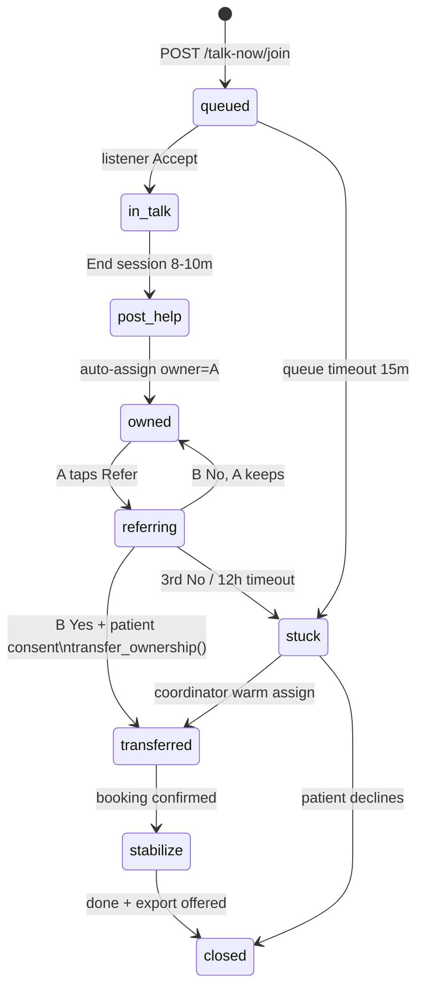

**Rules:** No edge skips consent. `owned` always has owner. `stuck` always notifies coordinator (push + dashboard row).

### 5.2 Referral State (per slide)

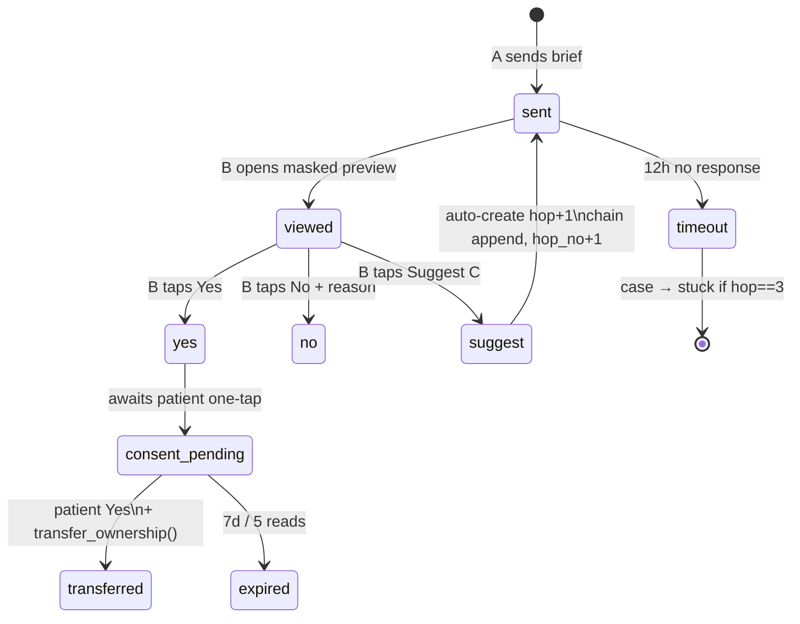

---

## 6. Sequence Diagrams (all core flows)

### 6.1 Talk Now Join + Anti-Abuse (FR-01/07)

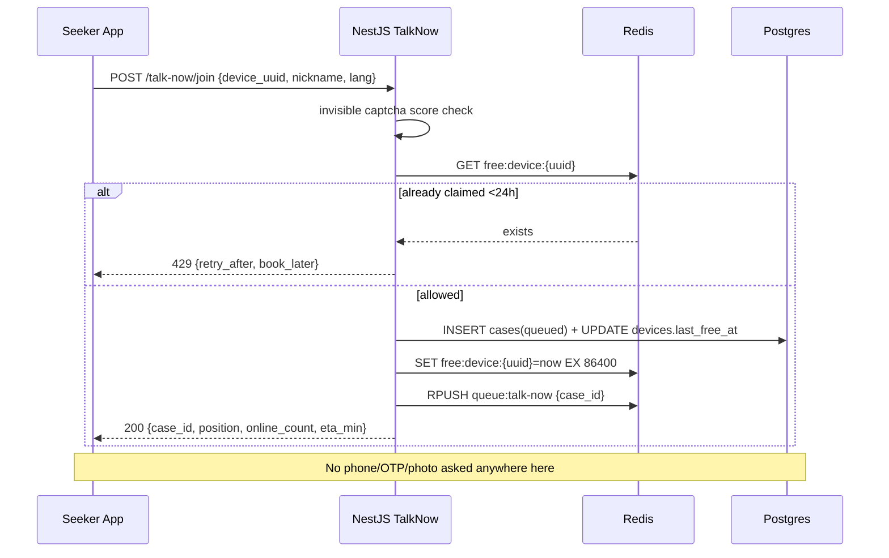

### 6.2 Session Accept + Chat/Audio

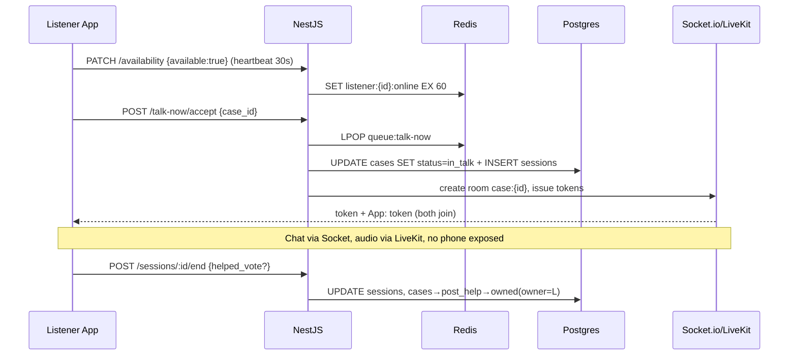

### 6.3 Referral Handshake - File Travels, User Doesn't (FR-18)

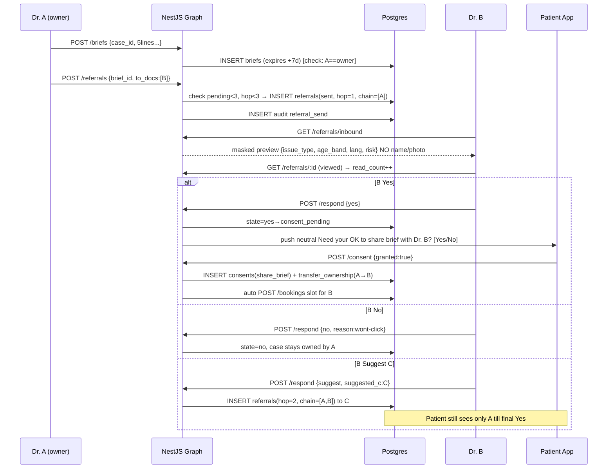

### 6.4 Max-Hop / Timeout → Coordinator (FR-19)

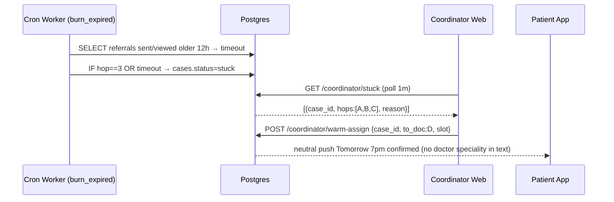

### 6.5 Safety High-Risk + Break-Glass (FR-47/48)

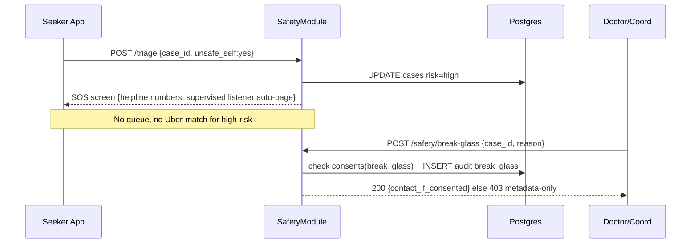

### 6.6 Wipe / Export (DPDP)

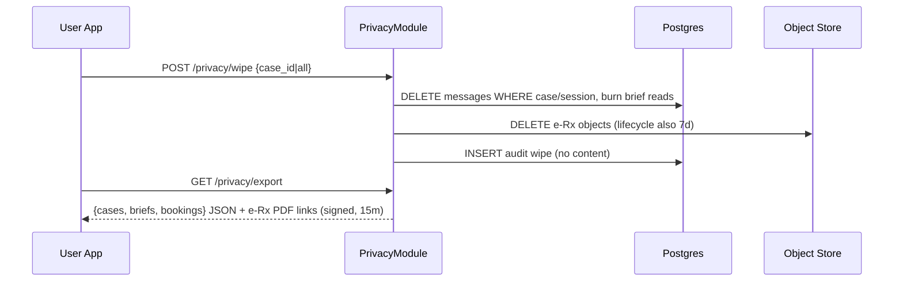

---

## 7. API Field-Level Spec

Base ` /api/v1` | Auth header `Authorization: Bearer <jwt>` | Errors `{code, message, retry_after?}`

### 7.1 `POST /talk-now/join`
Req: `{device_uuid: uuid, nickname: string(3-24), lang: hi|en, gender_pref?: no_pref|female|male, captcha_token: string}`
Res 200: `{case_id: uuid, position: int, online_count: int, eta_min: int, hours_open: bool, next_slot?: ISO}`
Res 429: `{code: FREE_LIMIT, retry_after_sec: 86400, book_later_slot: ISO}`
Guards: captcha score >0.5, Redis free-check, TalkHours soft (join allowed but ETA reflects next window).

### 7.2 `GET /talk-now/status?case_id=`
Res: `{position, online_count, eta_min, hours_open, sos:[{name, phone}]}`. Poll 5s or socket `queue:update`.

### 7.3 `POST /talk-now/triage`
Req: `{case_id, unsafe_self: yes|no|skip, unsafe_others?: yes|no|skip}`
Res low/med: `{action: queue}`. Res high: `{action: sos, helplines:[{name,phone}], auto_page: true}`.

### 7.4 `POST /talk-now/accept` (listener only)
Req: `{case_id}`. Checks: listener online, queue head, not own case. Res: `{session_id, livekit_token, alias, lang, risk}`. Side: LPOP, cases→in_talk.

### 7.5 `POST /briefs`
Req: `{case_id, presenting_5lines(10-1000ch), since_when, risk, phq9?:0-27, gad7?:0-21, meds_tried?, helped?, not_helped?, lang_pref?, gender_pref?}`. 403 if `req.user != case.owner`. Res: `{brief_id, expires_at}`.

### 7.6 `POST /referrals`
Req: `{brief_id, to_docs: [uuid] (1-2) | offapp: {phone_hash?, note?}}`. Checks: owner==me, `pending(to_doc)<3` (Redis+DB), `case.current_hop<3`. Res: `{referral_ids[], hop_no, chain}`. Off-app: res includes `{expiring_link: https://pb.link/r/<jwt7d>}`.

### 7.7 `GET /referrals/inbound` (B view - MASKED)
Res item: `{referral_id, hop_no, chain_len, masked:{issue_type: first30ch, age_band, lang, risk, phq9?, gad7?}, from_strength: int, expires_in_h: int}`. MUST NOT contain: name, phone, photo, full 5lines? (full shown only on detail after `viewed` + consent-pending? V1: full 5lines on detail, still no PII).

### 7.8 `POST /referrals/:id/respond` (B only)
Req: `{decision: yes|no|suggest, reason?: expertise|full|wont-click|language, suggested_c?: uuid}`. `suggest` requires `suggested_c` + auto-inserts hop+1 (fails 409 if hop==3 → case→stuck). Res: `{state}`.

### 7.9 `POST /referrals/:id/consent` (PATIENT anon JWT only)
Req: `{granted: bool}`. On true: `INSERT consents(share_brief)` + `transfer_ownership()` + auto-create `bookings(pending)` + push slot picker. Res: `{consent_id, new_owner_masked: Dr. B (first name + fee), slot_options: [...]}`.

### 7.10 `POST /bookings` / `GET /doctors/:id/availability`
Book req: `{case_id, doctor_id, slot_at: ISO future, modality: chat|audio}`. Res: `{booking_id, fee_snapshot, pay_note: Pay directly via UPI to doctor (no commission)}`.

### 7.11 Privacy/Safety/Coord (see Sec 6.5/6.6)
`POST /privacy/wipe {scope: case|all, case_id?}`, `GET /privacy/export`, `POST /safety/sos`, `POST /safety/break-glass {case_id, reason}` (coord/doctor, audit), `GET /coordinator/stuck`, `POST /coordinator/warm-assign {case_id, to_doc, slot_at}`.

---

## 8. Redis / Realtime Design

| Key | Type | What + How + TTL | Example |
|-----|------|------------------|---------|
| `free:device:{uuid}` | STR | 1 free/24h guard. SET on join. EX 86400. | `free:device:9f3... = 2026-10-10T19:02Z` |
| `queue:talk-now` | LIST | FIFO. RPUSH on join, LPOP on accept/skip. LLEN = queue len. Cap 50 → overflow mode. | `LLEN=7` |
| `queue:eta` | ZSET | `score=join_ts`, member=case_id. ETA = `pos * avg_handle(9m) / online_count`. | - |
| `listener:{id}:online` | STR | Heartbeat SET EX 60 every 30s. `KEYS listener:*:online` count = online_count (use SCAN in prod). | - |
| `pending:{doctor_id}` | INT | INCR on referral sent, DECR on respond/expire/timeout. Guard `>=3 → 409 suggest other`. EX none (DB reconciles nightly). | `pending:doc42=2` |
| `sess:{case_id}:token` | STR | LiveKit token cache EX 600. | - |

Socket events (`/ws/session`, auth via JWT query):
- `queue:update {position, eta_min, online_count}` (server→seeker room `case:{id}`)
- `message:send {session_id, body}` → server encrypts → `message:new {id, sender, created_at}` (never logs body)
- `session:wrap {mins_left}` at 8m, `session:close` at 10m
- `referral:inbound {referral_id}` (server→doctor room `doc:{id}`), neutral push mirrors it

---

## 9. Privacy Masking Matrix + Data Flows

### 9.1 Who Sees What (enforced in DTO serializers, NOT frontend)

| Field | Seeker anon | Listener (TalkNow) | Dr. B (masked preview) | Dr. B (after consent) | Coordinator |
|-------|-------------|--------------------|-----------------------|----------------------|-------------|
| nickname/alias | own | alias only | — (age-band only) | alias + age-band | alias |
| real name/phone/photo | never | never | NEVER | phone only if Rx-stage + consent | break-glass only + audit |
| presenting 5lines | own | full (session need) | issue_type 30ch preview → full on detail | full | metadata only |
| PHQ/GAD/meds | own | if in brief | scores only | full | no |
| chat body | own | session only | never | never (new session fresh) | NEVER (even break-glass needs separate grant) |
| fee/slot | final doc fee | — | — | own fee shown | own fee |
| chain A->B->C | final only | own hop | own hop + len | full chain (doctors) | full chain |

### 9.2 Data Flow: Brief Read (gated)
```
B GET /briefs/:id → Guard: referral to B exists + state in (viewed,yes,consent_pending)
→ Check consents? (preview allowed pre-consent but masked; full needs consent OR viewed-state)
→ read_count++ → audit brief_view → return DTO per matrix → if read_count>=max_reads → 410 on next
```

---

## 10. UI Screen Map + Navigation

```
Seeker:
/ (splash: TalkNow CTA, hours badge, SOS) 
 → /talk-now (nickname+lang) → /triage (skip) → /queue (pos+ETA) 
 → /session/:id (chat+audio+timer) → /post-help (vote+3 optional cards) 
 → /book/:doctorId (slots+UPI note) → /history (if account)

Doctor:
/d/login (OTP once) → /d/home (available toggle, pending n/3, inbound pings)
 → /d/session/:id (alias view) → /d/case/:id (Brief btn, Refer btn, chain)
 → /d/brief/new (5-line form, 2-min) → /d/refer (circle picker 1-2)
 → /d/inbound/:refId (masked card → Yes/No/SuggestC)

Coordinator:
/c/stuck (table: case, hops, risk, age) → /c/case/:id (warm assign picker)
```

**Navigation guards:** `/session` needs valid case+token; `/d/*` needs doctor JWT; `/c/*` needs coord JWT; anon JWT can't hit `/referrals/respond`.

---

## 11. Build Checklist for Implementation Session

> Implementation agent: execute top-down, tick boxes, don't skip DDL triggers.

- [ ] 1. Run Sec 4 DDL on PG16 India. Verify owner CHECK + hop CHECK fail-cases.
- [ ] 2. Scaffold NestJS modules per Sec 1.2 folders. Wire AuthGuard (anon/device JWT vs doctor OTP JWT vs coord).
- [ ] 3. TalkNow: `POST join` (captcha+Redis free+queue), `GET status`, Socket chat, LiveKit token, 8/10m timers.
- [ ] 4. Graph: circles CRUD (max10), briefs POST, referrals POST/respond, `transfer_ownership()` RPC only path, chain append, pending counter.
- [ ] 5. Consent: patient one-tap → consent row → transfer → booking draft. Off-app link JWT 7d.
- [ ] 6. Booking: availability + `direct_upi` lock + fee_snapshot. Post-help 3 cards.
- [ ] 7. Jobs: `burn_expired()` nightly + 12h timeout → stuck + coordinator push.
- [ ] 8. Privacy: masking DTOs per Sec 9.1, FLAG_SECURE+PIN, neutral FCM templates, wipe/export, audit append-only.
- [ ] 9. Safety: triage→SOS on high, break-glass + audit, helpline seed data.
- [ ] 10. Coordinator web minimal: stuck table + warm assign.
- [ ] 11. Seed: 6 test doctors with circles, 50 test devices, run pilot metrics (requirements Sec 9).
- [ ] 12. Tests MUST pass: single-owner never null on owned, hop4 rejected, pending4th rejected, brief read without consent → masked only, messages auto-burn, audit has no chat body.

**Open blockers to confirm with founders before Beta:** volunteer vs paid listeners, 2 vs 3 hops final, contribution split, e-Rx ID rules from psych friend, Flutter vs PWA final.

*End of DesignER v2.0 - ready for implementation session.*
